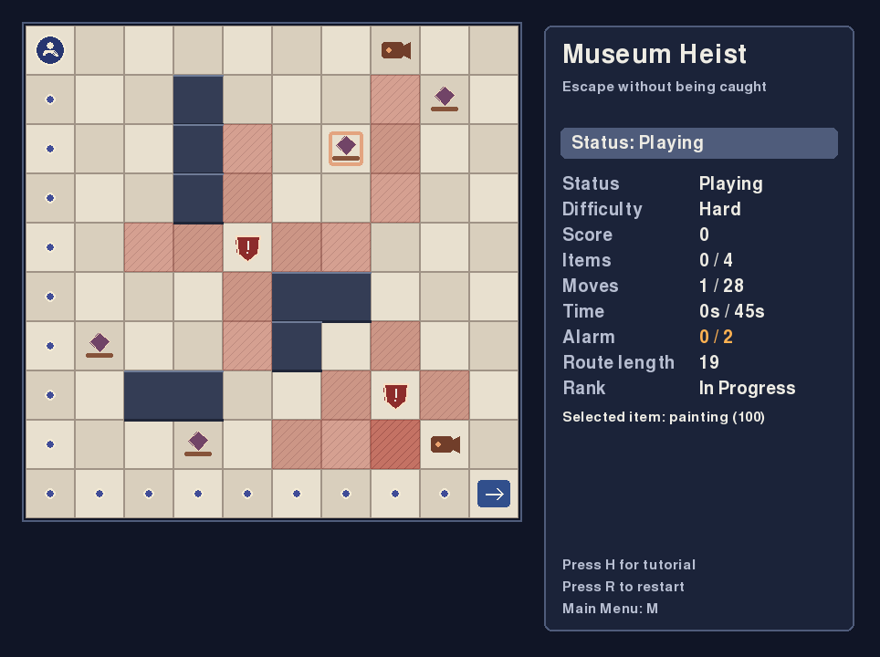
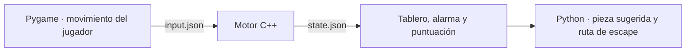

# Museum Heist

Un juego de sigilo de escritorio. Recorre las salas del museo, recoge piezas valiosas y encuentra la salida antes de activar la alarma. Cada movimiento cuenta: los guardias y las cámaras vigilan el tablero, y las paredes bloquean su visión.


[](LICENSE)

[Cómo jugar](#cómo-jugar) · [Inicio local](#inicio-local) · [Documentación](docs/README_DOCS.md) · [Póster académico](docs/Museum_Heist_Academic_Poster.pdf)

## Vista previa

La ruta sugerida aparece como puntos índigo y las zonas vigiladas se marcan con un tramado rojo. El panel lateral muestra el botín, el tiempo y el nivel de alarma.

<a href="docs/media/gameplay.png"></a>

## Cómo se resuelve un turno

La interfaz y el motor intercambian archivos JSON. Los algoritmos de Python usan el estado resultante para sugerir una pieza y una ruta.



## Cómo jugar

| Teclas | Acción |
| --- | --- |
| **1**, **2**, **3** | Elegir dificultad |
| **Enter** | Iniciar partida |
| **WASD** o flechas | Mover al jugador |
| **H** / **B** | Abrir el tutorial / regresar |
| **R** | Reiniciar la partida |
| **M** | Volver al menú |

Entrar en una zona vigilada termina la partida. Chocar con una pared aumenta la alarma. Recoge piezas para mejorar tu puntuación y llega a la salida antes de agotar el tiempo o los movimientos.

| Dificultad | Tablero | Límite de alarma | Movimientos | Tiempo |
| --- | --- | ---: | ---: | ---: |
| Fácil | 8 × 8 | 4 | 45 | 90 s |
| Normal | 8 × 8 | 3 | 35 | 60 s |
| Difícil | 10 × 10 | 2 | 28 | 45 s |

## Inicio local

Necesitas Python con Pygame y `g++` con soporte para C++17 en el PATH. Ejecuta desde la raíz del repositorio:

```bash
python -m pip install -r requirements.txt
python game/ui/main.py
```

El juego compila el motor al arrancar y abre una ventana de escritorio.

## Cómo está hecho

- **Pygame** dibuja el tablero, el menú y el panel de partida.
- **C++** resuelve movimientos, vigilancia, alarmas y puntuación. La interfaz y el motor intercambian el estado mediante JSON.
- **Python** usa un algoritmo voraz para sugerir una pieza y *backtracking* para buscar una ruta de escape.

Consulta el [informe técnico](docs/Museum_Heist_Technical_Report_11.pdf) para conocer la arquitectura y las decisiones del proyecto académico.
